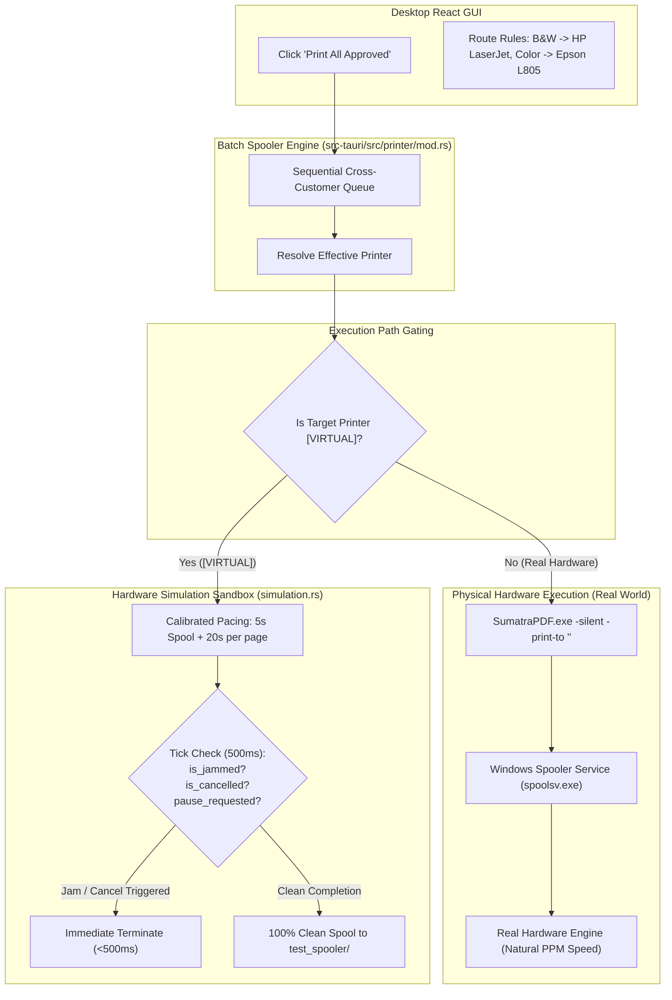

# PrintDrop Virtual Hardware Simulation & Sandbox Environment

## 1. Executive Summary & Purpose

When developing retail print shop POS software on Windows 11, developers and QA teams face specific hardware testing challenges:
1. **Physical Fleet Unavailability**: Developers rarely have 3–4 physical printers (B&W Laser, Color EcoTank, Large Format Plotter) attached to their local development workstation.
2. **The "Microsoft Print to PDF" Trap**: The built-in Windows `Microsoft Print to PDF` driver uses the `PORTPROMPT:` port. Headless automation tools (such as SumatraPDF `-print-to`) trigger an interactive **"Save Output File As" GUI dialog box** for every single file in the batch, halting automated batch execution.
3. **The 0.1s Execution Speed Dilemma**: Standard virtual file drivers process print jobs in ~100–300 milliseconds. This is too fast for human testers to test intermediate lifecycle events such as **Graceful Pause** (toner/paper reload), **Emergency Paper Jam**, or observe the **customer mobile screen live animation**.

The **PrintDrop Hardware Simulation Sandbox** introduces an isolated, paced virtual hardware layer that solves all these challenges without administrative Windows driver changes.

> [!IMPORTANT]
> **Strict Boundary Between Real Hardware vs Virtual Sandbox**:
> - **Real Physical Printers**: When printing to physical printers (e.g. `HP LaserJet 1020`, `Epson EcoTank L805`, `Canon PIXMA`), SumatraPDF is invoked directly via headless CLI:
>   `SumatraPDF.exe -silent -print-to "<PrinterName>" -print-settings "<settings>" "<filepath>"`
>   Physical printers take their own natural mechanical time (e.g. 20–35 PPM for laser, 5–15 PPM for inkjet, or 1–2 minutes for high-res photo printing). **No artificial delays, timers, or mock pacing apply to real printers.**
> - **Virtual Test Printers**: The 20s/page pacing and 5s spool pacing are **strictly gated** behind `simulation::is_simulated_printer(printer_name)` (which checks for `[VIRTUAL]` prefix or `Virtual Test Spooler`). Real printers bypass `simulation.rs` completely!

---

## 2. Virtual Hardware Fleet Architecture

When Simulation Mode is enabled (`printer_simulation_mode = true`), the system injects 4 virtual mock printers into all desktop dropdowns:

| Virtual Printer Name | Target Route | Simulated Physical Behavior |
|---|---|---|
| `[VIRTUAL] HP LaserJet 1020 (Counter B&W Laser)` | B&W Laser Documents & Resumes | 20.0s per page pacing, simplex/duplex |
| `[VIRTUAL] Epson EcoTank L805 (Color Photo Tank)` | Color Photos & Certificates | 20.0s per page pacing, photo simulation |
| `[VIRTUAL] Canon imagePROGRAF (Plotter A1/A0)` | Architectural / CAD Blueprints | 20.0s per page pacing, wide-format roll |
| `[VIRTUAL] Brother HL-L2321D (Backup B&W Printer)` | Standby / Jam Recovery Target | Standby target for 1-click cascading reroutes |



---

## 3. Pacing Engine & File System Storage Locations

### Pacing Engine Details:
Inside `src-tauri/src/printer/simulation.rs`:
- Every document is parsed for its actual page count via `lopdf` (e.g. 6-page PDF = 6 pages; single image = 1 page).
- **Calibrated Pacing Rate**: **5.0s Spooler Preparation + 20.0s per page Hardware Printing** (40 micro-ticks of 500ms per page).
  - A 6-page document takes 5s spool + (6 × 20s) = 125 seconds total.
  - The Desktop UI and Customer phone actively update with live dual circular progress rings and individual horizontal bars:
    `"Printing Page 2 of 6 on '[VIRTUAL] HP LaserJet 1020' (20s/page test pacing)..."`
- **Active Interrupt Checks (Every 500ms)**:
  1. `state.is_jammed`: If the shopkeeper clicks **`[Paper Jam]`** or a hardware stall is detected, the loop halts immediately (<500ms), tags the document as `FAILED`, and opens the Reroute Assistant.
  2. `state.is_cancelled`: If **`[Stop Batch]`** is clicked, it terminates immediately.
  3. `state.pause_requested`: If **`[Cartridge Pause]`** is clicked:
     - The button instantly flashes an **active amber pending state** (`Pausing after Page...`).
     - The engine completes the current page cleanly (to prevent half-printed paper waste), then halts the queue and shows the green **`[Continue]`** button.
  4. `reroute_printer_queue`:
     - The faulty printer card is **immediately hidden** from the UI.
     - Remaining pages auto-fill by default (`custom` range, e.g. `4-8`).
     - SQLite `orders.target_printer` is updated immediately so the **Customer Portal live status syncs to the new printer name**.

### Custom Range Slicing & Double-Filtering Fix:
- When a document is sliced for custom range recovery (e.g. pages 4–8 of an 8-page document):
  - `prepare_pdf_document` physically extracts the 5 remaining pages to a temporary PDF.
  - `determine_pages_to_simulate` inspects `is_prefiltered: bool` to prevent the temporary 5-page PDF from being double-clamped against `4-8`.
  - The engine prints all 5 pages sequentially, accurately displaying `P-4/8`, `P-5/8`, `P-6/8`, `P-7/8`, `P-8/8` with **zero skipped pages**.

### File System Storage Architecture (Where files live on C: drive):
All files in PrintDrop reside in standard Windows `%APPDATA%\PrintDrop` (`C:\Users\<username>\AppData\Roaming\PrintDrop`):

1. **Customer Uploaded Files**:
   - Chunked Upload Staging: `C:\Users\<username>\AppData\Roaming\PrintDrop\storage\temp\chunks\<file_id>\chunk_0.part, chunk_1.part...`
   - Assembly Staging: `C:\Users\<username>\AppData\Roaming\PrintDrop\storage\temp\assembled\<file_id>.part`
   - Verified Permanent Storage: `C:\Users\<username>\AppData\Roaming\PrintDrop\storage\verified\<file_id>.dat` (stored with extensionless UUID names, matching SHA-256 hashes).
2. **Where Print Jobs Go**:
   - In Virtual Simulation Mode:
     A copy of every processed document spooled during simulation is saved to:
     `C:\Users\<username>\AppData\Roaming\PrintDrop\storage\test_spooler\<filename>`
   - In Physical Printing Mode:
     SumatraPDF sends print commands directly to the Windows Print Spooler service (`spoolsv.exe`). Windows temporarily holds `.SPL` (Spool data) and `.SHD` (Shadow tracking) files in `C:\Windows\System32\spool\PRINTERS` until dispatched to the printer's physical hardware memory. Audit logs of all jobs are kept in `C:\Users\<username>\AppData\Roaming\PrintDrop\printdrop.db` in SQLite table `print_jobs`.

---

## 4. End-to-End Testing Runbook (Step-by-Step)

### Step 1: Open the Application & Route Rules
1. Launch PrintDrop via VS Code: `Run > Run Without Debugging` (or `npm run tauri dev`).
2. In the top header bar, click **"Route Rules"**.
3. You will see the cyan banner: `🧪 Hardware Simulation Sandbox [ACTIVE]`.
4. Click **`[Apply Virtual Preset]`** and click **`Save Route Rules`**.

### Step 2: Create Test Customer Orders
1. Open the Customer Portal in your phone or browser: `http://localhost:3000/customer.html`.
2. Upload 3–4 PDF/Image files across 2 different customer orders.
3. On Desktop POS, click **`Approve`** on both orders.
4. Click **`[🖨️ Print All Approved]`**.

### Step 3: Test Cartridge / Toner Pause & Resume Workflow
1. While a file is printing, click **`[Cartridge Pause]`**.
2. Notice the button immediately illuminates in **pulsing amber**: `Pausing after Page...`.
3. The engine cleanly finishes the current page, pauses the queue, and shows the green **`[Continue]`** button.
4. Click **`[Continue]`** &rarr; Printing resumes seamlessly from the next page!

### Step 4: Test Paper Jam & 1-Click Cascading Rerouting
1. While a file is printing (e.g. Page 4 of 8), click **`[Paper Jam]`**.
2. The spooler halts instantly (<500ms):
   - Button flashes emergency red: `🚨 Paper Jam Active`.
   - The **Hardware Reroute & Jam Recovery Assistant** drawer automatically opens.
   - Resume mode is pre-selected to **`Resume remaining pages only`** with custom range `4-8`.
3. Select the replacement printer (e.g. `[VIRTUAL] Brother HL-L2321D`).
4. Click **`[Apply Reroute Now]`**:
   - The faulty printer card is **immediately hidden** from the UI.
   - The new printer card starts printing all 5 remaining pages (`P-4/8`, `P-5/8`... `P-8/8`).
   - The Customer Portal immediately updates the displayed **Assigned Printer** to `[VIRTUAL] Brother HL-L2321D`!

---

## 5. Verification Commands

```powershell
# 1. Run simulation unit tests
cargo test test_simulation_mode_and_virtual_printers_listing --manifest-path src-tauri/Cargo.toml
cargo test test_simulated_paged_print_and_emergency_jam_interruption --manifest-path src-tauri/Cargo.toml

# 2. Run all printer tests (18 tests)
cargo test printer::tests --manifest-path src-tauri/Cargo.toml

# 3. Verify frontend build
npm run build
```
