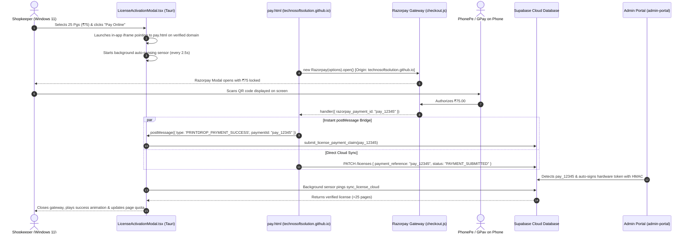

# Razorpay Desktop Embedded In-Context Modal Checkout Workflow

> [!IMPORTANT]
> **Desktop Applications Only (Tauri / Electron / WebView2)**:
> This workflow is specifically designed for **Desktop Operating Systems (Windows 11 / 10, macOS, Linux)** inside desktop shells.
> It is **NOT** for mobile customer web portals (which use `razorpay-fast-forward-upi-intent` for 1-tap Android UPI sheet switching). Desktop systems require an in-window payment modal supporting QR code scanning, NetBanking, Credit/Debit cards, Wallets, and UPI VPA entry.

---

## §1: Why Desktop Requires a Distinct Payment Architecture

| Dimension | Customer Portal (Mobile Web) | Station Counter App (Desktop Windows 11) |
| :--- | :--- | :--- |
| **User Device** | Customer's Android / iOS Smartphone | Shopkeeper's Windows 11 Billing Station PC |
| **Payment Workflow** | **Fast-Forward UPI Intent (`upi://pay` / Intent Link)** | **Verified Domain In-Context Modal (`pay.html`)** |
| **Interaction Model** | 1-tap direct Android App Sheet (GPay, PhonePe, Paytm) | In-app floating modal with QR code, Cards, NetBanking, UPI VPA |
| **Primary Pay Mode** | Native UPI App installed on same device | Scan-to-pay QR on screen or Card/NetBanking on desktop |
| **SDK / Engine** | Direct URL intent switch / Mode 19 Standee | Client-side `checkout.js` on verified domain via WebView2 iframe |
| **Redirection Risk** | Opening external URLs can kill mobile browser tab | Direct localhost origins trigger "Website does not match registered websites" error |

---

## §2: Core Pitfalls & Battle-Tested Solutions

### 1. The Razorpay Domain Whitelisting Trap ("Payment blocked as website does not match registered websites")
- **Trap**: Running `checkout.js` directly on `http://127.0.0.1:1420` or `tauri://localhost` inside WebView2 in Live Mode (`rzp_live_...`).
- **Symptom**: The customer scans the QR code or submits payment, but Razorpay's Live Risk Engine blocks it:
  `Payment Failed : Business failure//Others .. Payment blocked as website does not match registered websites.`
- **Permanent Solution**: Host the checkout gateway on your KYC-approved HTTPS domain registered in Razorpay Dashboard (`https://technosoftsolution.github.io/printdrop-station/pay.html`).
  - In the desktop app, embed `pay.html` inside an in-app iframe modal (`allow="payment; camera"`).
  - Razorpay detects the `Origin` as `https://technosoftsolution.github.io`, completely satisfying the domain whitelist!

### 2. The Automatic Payment Sensing & Navigation Mechanism
- **Requirement**: Once the user pays via mobile UPI app, the desktop app must detect completion and update license pages automatically without manual page refreshes or UTR typing.
- **Permanent Solution**: Dual-layer detection:
  1. **Layer A (`postMessage`)**: When payment succeeds in the iframe, `pay.html` dispatches `window.parent.postMessage({ type: 'PRINTDROP_PAYMENT_SUCCESS', paymentId, plan, pages, amount })`.
  2. **Layer B (Supabase Background Sensor)**: Simultaneously, the desktop app runs a background sensor (`setInterval(sync_license_cloud, 2500)`). The moment `pages_granted` increases or `payment_status` changes in Supabase, the poller closes the modal, fires the green celebration animation, and updates local quota counters!

### 3. Automated Token Signing in Admin Portal
- When `pay.html` receives a live payment from Razorpay (`pay_Q1w2...`), it directly records `payment_status: 'PAYMENT_SUBMITTED'` and `payment_reference: 'pay_...'` in Supabase.
- When `admin-portal/index.html` loads or refreshes, any pending claim with a verified `pay_` reference is automatically signed with `MASTER_SIGNING_SECRET`, activating the license in seconds!

---

## §3: End-to-End System Architecture

---

## §4: Hybrid Plan Metering Architecture & Timezone-Resilient Signing

### 1. Hybrid Plan Architecture (Subscription + Page Wallet)
- **Problem**: When a shopkeeper purchases an Unlimited Subscription (e.g., 1 Month Unlimited for ₹299) while already owning a Prepaid Page Wallet (e.g., 1,355 pages), standard systems overwrite the wallet pages to `null` or wipe the subscription expiry when recharging pages.
- **Solution**:
  - **Admin Approval & Upgrade**: Approving a Subscription preserves existing `pages_granted` in secondary reserve and resets `issued_at = now` so subscription "Days Consumed" starts from Day 0. Approving a Wallet Pack preserves active `expires_at`.
  - **Desktop Display**: If hybrid (`days_remaining > 0` on subscription AND `pages_granted > 0`), the station displays both metrics:
    - Primary Card: `Unlimited Subscription (X days left)`
    - Secondary Card: `Page Wallet: Y pgs in Reserve (No Expiry)`
  - **Admin Fleet Table**: The Active Plan column renders two stacked lines:
    - Line 1: `🕒 1 Month Unlimited • X days left`
    - Line 2: `💳 Page Wallet: 1,355 pgs (Reserve) • No Expiry`
  - **Zero-Waste Metering**: During an active unlimited subscription, `record_printed_pages()` increments `pages_printed_lifetime` without deducting from `pages_used`. If the subscription ever expires, the station seamlessly switches to deducting from the reserved page wallet without pausing printing.

### 2. Timezone-Resilient Signature Verification
- **Problem**: Supabase Postgres `timestamp with time zone` converts UTC strings (`2026-11-08T17:45:23.537898+00:00`) to local offset (`2026-11-08T23:15:23.537898+05:30`). Comparing literal string representations in HMAC canonical inputs causes verification failures when pulling synced licenses.
- **Solution**: Rust's `verify_license_signature` normalizes parsed ISO timestamps to multiple standard representations (raw string, UTC RFC3339, and microsecond `+00:00`) and supports both enum PascalCase and SCREAMING_SNAKE_CASE plan codes.

---

## §5: Verification Runbook

1. **Verify Verified Domain Loading**:
   - Open **Station Hardware ID & License > Upgrade / Renew License**.
   - Select **25 Pages (₹75)**.
   - Click **"Pay ₹75 via UPI / Apps →"**.
   - The in-app payment sheet opens displaying `Secure Payment Gateway • technosoftsolution.github.io`.
2. **Verify Payment Processing**:
   - Scan the dynamic QR code with PhonePe / GPay.
   - Complete the payment of ₹75.
   - Razorpay will approve the transaction without any "website does not match registered websites" error.
3. **Verify Automated Sensing**:
   - Within 2-3 seconds of completing payment on your phone, the desktop app detects completion.
   - The payment gateway modal automatically dismisses.
   - The license state updates with **+25 pages** and displays the success confirmation banner.
4. **Verify Hybrid & Admin Display**:
   - Open [admin-portal/index.html](file:///C:/Flutter_src/PrintDrop/admin-portal/index.html) in browser.
   - Stations with both active subscription and page wallet display dual stacked rows.
   - Days consumed shows `Page Metered` for wallet packs or `X day(s)` from cycle start for subscriptions.
   - `(Trial)` suffix is automatically stripped from active commercial shops.
