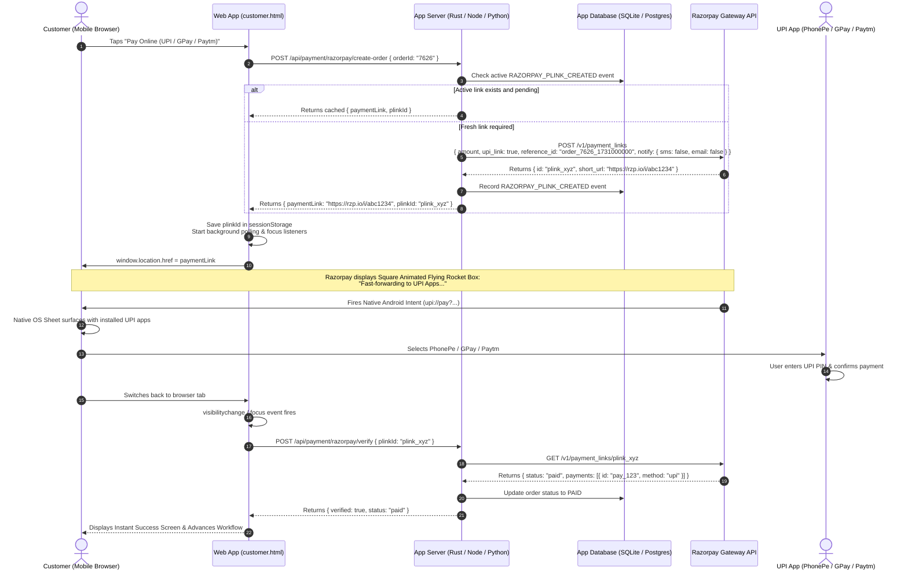

# Razorpay Fast-Forward UPI Intent (1-Tap Zero-Interactive) Workflow

## Purpose & Architecture Overview

The **Razorpay Fast-Forward UPI Intent Link** workflow provides the fastest, lowest-friction online payment experience for mobile web and PWA applications in India.

Unlike traditional Razorpay integrations that force users through multi-step forms:
1. **Standard Modal (`checkout.js`)**: Floats a modal that asks the user for mobile number, email, and payment methods. Often fails or gets blocked inside in-app webviews or triggers unwanted OTP popups.
2. **Hosted Payment Page (`https://rzp.io/l/...`)**: Redirects users to an interactive web page listing cards, netbanking, wallets, and UPI, requiring manual clicks.
3. **Fast-Forward UPI Intent (`https://rzp.io/i/...` with `"upi_link": true`)**: **Zero intermediate forms**. The customer taps **Pay Online**, sees Razorpay's animated flying rocket box (`Fast-forwarding to UPI Apps...`), and the mobile OS immediately surfaces the native bottom sheet chooser with all installed UPI apps (**PhonePe, Google Pay, Paytm, BHIM, Navi, CRED**). Tapping any app immediately opens that app with the exact amount and VPA prefilled.

---

## Quick Reference & Pitfall Table

| Problem / Trap | Root Cause | Production Solution |
| :--- | :--- | :--- |
| **"Payment link with given reference_id already exists"** | Passing static `order_id` as `reference_id` to `POST /v1/payment_links`. Razorpay enforces strict global uniqueness across all created links. | 1. Check database for active/pending plink and reuse it.<br>2. When creating fresh link, append timestamp: `format!("{}_{}", receipt, Utc::now().timestamp())`. |
| **User prompted for Mobile Number / Interactive Form** | Using `checkout.js` modal or Hosted Page (`/l/`) instead of Fast-Forward UPI Link (`/i/`). | Set `"upi_link": true` in `POST /v1/payment_links` and navigate directly via `window.location.href = data.paymentLink`. |
| **Customer returns from PhonePe/GPay but UI still says "Pending"** | User switches back to browser tab without completing callback or page reload drops state. | Cache `plinkId` in `sessionStorage`. Hook `document.addEventListener("visibilitychange")` and `window.addEventListener("focus")` to auto-poll `/api/payment/razorpay/verify`. |
| **Dirty browser URL after payment (`?razorpay_payment_id=...`)** | Razorpay appends tracking parameters to return URL on redirect back. | Run `window.history.replaceState({}, document.title, window.location.pathname)` immediately on page load to clean history. |
| **Unwanted SMS / Email spam sent to customer** | Default Razorpay link options notify customer via SMS/Email. | Explicitly disable in payload: `"notify": { "sms": false, "email": false }`. |

---

## §1: End-to-End System Sequence Diagram



---

## §2: Backend Implementation Runbook

### 1. Unique Reference ID Formulation
Razorpay enforces strict global uniqueness on `reference_id`. If a user taps "Pay Online", presses back, and taps again, using the raw `order_id` will trigger:
`HTTP 400: payment link with given reference_id: 7626 already exists`.

**Solution**: Combine order ID with a timestamp suffix and cache the active link:
```rust
// Rust implementation
let unique_ref = format!("{}_{}", &receipt_id[..receipt_id.len().min(26)], chrono::Utc::now().timestamp());
```

```javascript
// Node.js implementation
const uniqueRef = `${receiptId.slice(0, 26)}_${Math.floor(Date.now() / 1000)}`;
```

```python
# Python implementation
unique_ref = f"{receipt_id[:26]}_{int(time.time())}"
```

### 2. Creating the Razorpay UPI Link (`POST /v1/payment_links`)
Make an authenticated HTTP POST request with Basic Auth (`key_id:key_secret`):

```json
{
  "amount": 2500,
  "currency": "INR",
  "accept_partial": false,
  "reference_id": "order_7626_1731000000",
  "description": "Order #7626 PrintDrop",
  "upi_link": true,
  "notify": {
    "sms": false,
    "email": false
  },
  "reminder_enable": false,
  "callback_url": "https://your-domain.com/customer?orderId=7626",
  "callback_method": "get"
}
```

> [!IMPORTANT]
> The crucial field is `"upi_link": true`. This instructs Razorpay to generate a special `https://rzp.io/i/...` short URL that serves the fast-forwarding flying rocket loader and immediately triggers the native Android UPI intent.

### 3. Backend Verification Endpoint (`POST /api/payment/razorpay/verify`)
When the customer returns, verify payment status directly with Razorpay:

```rust
// Rust Axum verification handler
pub async fn verify_razorpay_payment_endpoint(
    State(state): State<AppState>,
    Json(payload): Json<VerifyRequest>,
) -> Result<Json<serde_json::Value>, StatusCode> {
    let settings = state.settings.read().unwrap().clone();
    let client = reqwest::Client::new();
    
    // Check payment link status from Razorpay API
    let rzp_res = client
        .get(format!("https://api.razorpay.com/v1/payment_links/{}", payload.plink_id))
        .basic_auth(&settings.razorpay_key_id, Some(&settings.razorpay_key_secret))
        .send()
        .await
        .map_err(|_| StatusCode::INTERNAL_SERVER_ERROR)?;

    let plink_data: serde_json::Value = rzp_res.json().await.unwrap_or_default();
    let status = plink_data["status"].as_str().unwrap_or("");

    if status == "paid" {
        // Record payment in DB and broadcast WebSocket event
        state.db.with_conn(|conn| {
            conn.execute(
                "UPDATE orders SET payment_status = 'PAID', updated_at = datetime('now') WHERE id = ?1",
                rusqlite::params![payload.order_id],
            )?;
            Ok(())
        }).unwrap();

        return Ok(Json(serde_json::json!({ "verified": true, "status": "paid" })));
    }

    Ok(Json(serde_json::json!({ "verified": false, "status": status })))
}
```

---

## §3: Frontend Implementation Runbook (`customer.html`)

### 1. 1-Tap Trigger (`payWithRazorpay`)
```javascript
async function payWithRazorpay() {
    const btn = document.getElementById("pay-online-btn");
    btn.disabled = true;
    btn.innerHTML = `<span class="spinner"></span> Contacting Razorpay...`;

    try {
        const res = await fetch("/api/payment/razorpay/create-order", {
            method: "POST",
            headers: { "Content-Type": "application/json" },
            body: JSON.stringify({ orderId: currentOrderId })
        });
        const data = await res.json();

        if (!data.success || !data.paymentLink) {
            alert("Could not initialize payment: " + (data.error || "Unknown error"));
            btn.disabled = false;
            return;
        }

        // Cache plinkId for recovery when returning from UPI app
        sessionStorage.setItem("pending_plink_" + currentOrderId, data.plinkId);

        // Dispatches directly to Razorpay's fast-forwarding rocket gateway
        // No intermediate web forms, no phone number prompt!
        window.location.href = data.paymentLink;

    } catch (err) {
        console.error("Payment error:", err);
        btn.disabled = false;
    }
}
```

### 2. State Recovery & Return URL Sanitization
When the customer completes the payment in PhonePe/Google Pay and switches back to the browser:
```javascript
// Clean any tracking query parameters left in the URL
if (window.location.search.includes("razorpay_")) {
    window.history.replaceState({}, document.title, window.location.pathname);
}

// Auto-verify when user switches back to browser tab
document.addEventListener("visibilitychange", () => {
    if (document.visibilityState === "visible") {
        checkPendingPlinkVerification();
    }
});

window.addEventListener("focus", () => {
    checkPendingPlinkVerification();
});

async function checkPendingPlinkVerification() {
    const plinkId = sessionStorage.getItem("pending_plink_" + currentOrderId);
    if (!plinkId) return;

    try {
        const res = await fetch("/api/payment/razorpay/verify", {
            method: "POST",
            headers: { "Content-Type": "application/json" },
            body: JSON.stringify({ orderId: currentOrderId, plinkId: plinkId })
        });
        const result = await res.json();

        if (result.verified && result.status === "paid") {
            sessionStorage.removeItem("pending_plink_" + currentOrderId);
            showPaymentSuccessScreen();
        }
    } catch (e) {
        console.warn("Plink auto-verification poll error:", e);
    }
}
```

---

## §4: Comparison Matrix

| Feature | Embedded Modal (`checkout.js`) | Hosted Payment Page (`/l/`) | Fast-Forward UPI Intent (`/i/`) |
| :--- | :--- | :--- | :--- |
| **Number of Taps to UPI App** | 3-4 taps (tap Pay, enter phone, select UPI, select app) | 3-4 taps (tap Pay, browse options, select UPI, tap Pay) | **1 tap** (tap Pay $\rightarrow$ UPI apps sheet pops) |
| **Intermediate Phone Number Prompt** | **Yes** (unless pre-verified contact is passed) | **Yes** (standard form field) | **None** (zero prompts) |
| **Flying Rocket Animation Screen** | No (circular spinner or standard modal) | No (static Razorpay hosted page) | **Yes** (Razorpay horizontal flying rocket box) |
| **Supported Devices** | Desktop & Mobile | Desktop & Mobile | **Mobile Web & PWA** (Android & iOS) |
| **UPI Intent Bottom Sheet** | Inconsistent across in-app browsers | No (requires extra clicks) | **Immediate & Automatic** via OS intent |
| **Best Used For** | Desktop card/netbanking payments | Invoice billing links sent via SMS | **High-speed retail counters & walk-in customer mobile portals** |
