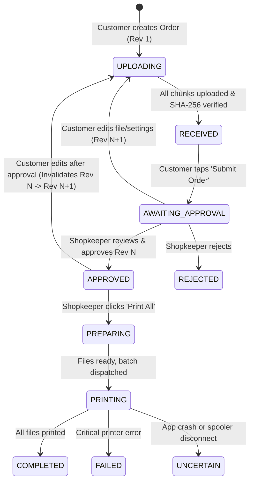
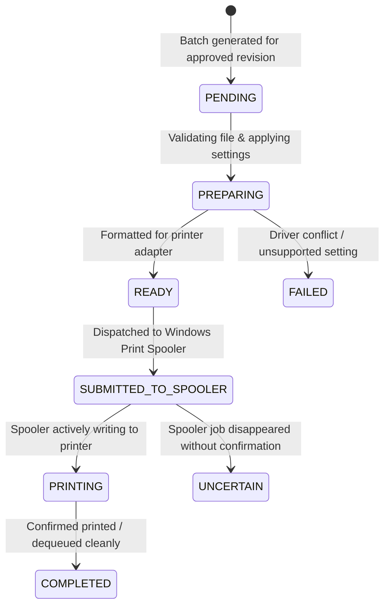

# PrintDrop Architecture Specification

## 1. System Overview & Vision

**PrintDrop** is a QR-based file transfer, order management, and shopkeeper-controlled batch printing solution designed for retail printing shops, photocopy centers, and cybercafés on **Windows 11**.

The system enables a frictionless, **Zero-Install** mobile experience for customers:
- A customer walks into the shop, scans a QR code displayed on the shopkeeper's Windows desktop screen using their phone's ordinary camera/scanner.
- The phone opens a responsive web application (`http://<LAN_IP>:<PORT>/?session=<TOKEN>`) directly in their mobile browser (Chrome, Safari, Samsung Internet).
- The customer selects multiple files, configures independent print settings per file (Auto vs. Manual: paper size, duplex, color/grayscale, copies), and uploads them over the local Wi-Fi.
- The shopkeeper reviews incoming orders, inspects the requested settings against printer capabilities, approves the exact revision, and executes batch printing with a single click.
- Real-time order progress (*Received → Approved → Printing File X of Y → Completed*) is streamed back to the customer's mobile browser.

---

## 2. High-Level Architecture Diagram

```mermaid
flowchart TB
    subgraph CustomerDevice["Customer Mobile Phone (Android / iOS Browser)"]
        Camera["Native Camera / QR Scanner"]
        MobileWeb["Mobile Web UI (React + Vite + TypeScript)"]
        Chunker["Resumable Chunk Uploader (Blob.slice)"]
        SSEListener["Realtime Status Listener (EventSource / Polling)"]
    end

    subgraph WindowsHost["Windows 11 Desktop Application (Tauri 2)"]
        subgraph FrontendLayer["Shopkeeper Frontend (React + Vite + TypeScript)"]
            DashboardUI["Orders Dashboard & Inspector"]
            ApprovalUI["Approval & Print Control"]
            BatchProgressUI["Live Animated Batch Progress"]
            SettingsUI["Printer & Network Configuration"]
        end

        subgraph RustBackend["Tauri 2 Privileged Rust Core"]
            HttpServer["Embedded HTTP Server (Axum)"]
            SessionEngine["Session & Security Guard"]
            UploadEngine["Chunk Assembler & SHA-256 Verifier"]
            OrderEngine["Order & Immutable Revision Engine"]
            StorageEngine["Atomic File Storage & Sanitizer"]
            PrintAdapter["Print Engine & Spooler Adapter"]
            SQLiteRepo["SQLite WAL Repository (rusqlite)"]
            EventBus["Status Broadcast Event Bus (SSE)"]
        end
    end

    subgraph OSPrinting["Windows 11 Subsystem"]
        WinSpool["Windows Print Spooler (winspool.drv)"]
        Sumatra["SumatraPDF Headless Engine"]
        PhysicalPrinter["Physical or Virtual Printer"]
    end

    Camera -->|Scans QR Code| MobileWeb
    MobileWeb --> Chunker
    MobileWeb --> SSEListener

    Chunker -->|POST /api/upload/chunk| HttpServer
    SSEListener <-->|GET /api/orders/:id/events| HttpServer

    HttpServer --> SessionEngine
    HttpServer --> UploadEngine
    HttpServer --> OrderEngine
    UploadEngine --> StorageEngine
    OrderEngine --> SQLiteRepo
    EventBus <--> HttpServer

    FrontendLayer <-->|Tauri IPC Commands & Events| RustBackend

    ApprovalUI -->|invoke('execute_batch_print')| PrintAdapter
    PrintAdapter --> Sumatra
    PrintAdapter --> WinSpool
    Sumatra --> WinSpool
    WinSpool --> PhysicalPrinter
```

---

## 3. Component Boundaries & Modular Responsibilities

| Component | Technology | Primary Responsibility |
| :--- | :--- | :--- |
| **Shopkeeper Desktop UI** | React 18, TypeScript, Tailwind CSS, Vite | Shopkeeper dashboard, network status, QR generation display, incoming order inspector, approval controls, animated batch progress, and settings. |
| **Customer Mobile Web UI** | React 18, TypeScript, Tailwind CSS, Vite | Zero-install web client served over LAN. Handles file selection, per-file print configuration, client-side preflight validation, chunked resumable upload, and real-time status. |
| **Embedded HTTP Receiver** | Rust (`axum`), `tokio` runtime | Embedded web server running inside the Tauri process. Serves the static mobile web assets and handles REST API / SSE endpoints over the shop's LAN IP. |
| **Session & Security Service** | Rust | Issues cryptographically unpredictable session tokens (CSPRNG), manages session lifetimes (expiry, revocation), rate-limiting, and order access isolation. |
| **Storage Service** | Rust (`std::fs`, `tokio::fs`) | Manages temporary chunk staging (`temp/chunks/<file_id>/`), atomic file assembly, SHA-256 verification, path sanitization, and promotion to durable storage. |
| **Order & Revision Service** | Rust, SQLite transactions | Maintains immutable snapshots of orders and file settings. Any modification by the customer creates a new revision and automatically invalidates prior approvals. |
| **Document Intelligence & Preview Service** | Rust (`quick-xml`, `zip`), OpenXML parser | Deeply inspects Excel (`.xlsx`, `.xls`), PDF, Image, Word, and PowerPoint files. Automatically discovers sheet counts, populated cell bounds, author `<pageSetup>` (orientation, paper size, fit-to-width), pre-defined print areas, and serves secure preview endpoints. |
| **Print Adapter Engine** | Rust, `winspool.drv`, SumatraPDF | Decoupled print adapter abstraction. Submits documents to Windows Print Spooler with requested settings (duplex, copies, color), probes printer capabilities, and tracks spooling states. |
| **SQLite WAL Repository** | SQLite 3 via `rusqlite` | Durable transactional store for sessions, orders, revisions, files, print jobs, and configuration. Survives application restarts without data loss. |
| **Status Event Service** | Rust (`tokio::sync::broadcast`) | Server-Sent Events (SSE) broadcaster pushing real-time order state changes to both the desktop UI and customer mobile browser. |

---

## 4. Detailed SQLite Relational Schema (DDL)

```sql
-- SQLite Schema: Migration 001_initial_schema.sql
PRAGMA foreign_keys = ON;

-- 1. Transfer Sessions
CREATE TABLE transfer_sessions (
    id TEXT PRIMARY KEY,                       -- UUID v4
    token TEXT NOT NULL UNIQUE,                -- Cryptographic session secret
    lan_ip TEXT NOT NULL,                      -- IP address bound at creation
    port INTEGER NOT NULL,                     -- Port number
    status TEXT NOT NULL CHECK(status IN ('ACTIVE', 'EXPIRED', 'REVOKED')),
    max_file_size_bytes INTEGER NOT NULL DEFAULT 52428800, -- 50 MB
    max_order_size_bytes INTEGER NOT NULL DEFAULT 209715200, -- 200 MB
    max_files_count INTEGER NOT NULL DEFAULT 20,
    created_at DATETIME NOT NULL DEFAULT CURRENT_TIMESTAMP,
    expires_at DATETIME NOT NULL
);

-- 2. Orders
CREATE TABLE orders (
    id TEXT PRIMARY KEY,                       -- UUID v4
    session_id TEXT NOT NULL,
    current_revision_number INTEGER NOT NULL DEFAULT 1,
    status TEXT NOT NULL CHECK(status IN (
        'UPLOADING', 'RECEIVED', 'AWAITING_APPROVAL', 
        'APPROVED', 'PREPARING', 'PRINTING', 
        'COMPLETED', 'FAILED', 'UNCERTAIN', 'REJECTED', 'CANCELLED'
    )),
    customer_notes TEXT,
    created_at DATETIME NOT NULL DEFAULT CURRENT_TIMESTAMP,
    updated_at DATETIME NOT NULL DEFAULT CURRENT_TIMESTAMP,
    FOREIGN KEY (session_id) REFERENCES transfer_sessions(id) ON DELETE CASCADE
);

-- 3. Order Revisions (Immutable)
CREATE TABLE order_revisions (
    id TEXT PRIMARY KEY,                       -- UUID v4
    order_id TEXT NOT NULL,
    revision_number INTEGER NOT NULL,
    total_files INTEGER NOT NULL,
    total_bytes INTEGER NOT NULL,
    is_approved BOOLEAN NOT NULL DEFAULT 0,
    created_at DATETIME NOT NULL DEFAULT CURRENT_TIMESTAMP,
    UNIQUE(order_id, revision_number),
    FOREIGN KEY (order_id) REFERENCES orders(id) ON DELETE CASCADE
);

-- 4. Files
CREATE TABLE files (
    id TEXT PRIMARY KEY,                       -- UUID v4
    order_id TEXT NOT NULL,
    original_filename TEXT NOT NULL,
    sanitized_filename TEXT NOT NULL,
    detected_mime_type TEXT NOT NULL,
    file_extension TEXT NOT NULL,
    created_at DATETIME NOT NULL DEFAULT CURRENT_TIMESTAMP,
    FOREIGN KEY (order_id) REFERENCES orders(id) ON DELETE CASCADE
);

-- 5. File Revisions (Immutable)
CREATE TABLE file_revisions (
    id TEXT PRIMARY KEY,                       -- UUID v4
    file_id TEXT NOT NULL,
    order_revision_id TEXT NOT NULL,
    file_size_bytes INTEGER NOT NULL,
    sha256_hash TEXT NOT NULL,                 -- Verified after full upload
    storage_relative_path TEXT NOT NULL,       -- Path relative to storage root
    is_deleted BOOLEAN NOT NULL DEFAULT 0,
    transfer_status TEXT NOT NULL CHECK(transfer_status IN ('PENDING', 'UPLOADING', 'VERIFIED', 'FAILED')),
    created_at DATETIME NOT NULL DEFAULT CURRENT_TIMESTAMP,
    FOREIGN KEY (file_id) REFERENCES files(id) ON DELETE CASCADE,
    FOREIGN KEY (order_revision_id) REFERENCES order_revisions(id) ON DELETE CASCADE
);

-- 6. Print Settings (Per File Revision)
CREATE TABLE print_settings (
    id TEXT PRIMARY KEY,                       -- UUID v4
    file_revision_id TEXT NOT NULL UNIQUE,
    mode TEXT NOT NULL CHECK(mode IN ('AUTO', 'MANUAL')),
    paper_size TEXT NOT NULL DEFAULT 'A4',     -- 'A4', 'LETTER', 'LEGAL'
    color_mode TEXT NOT NULL DEFAULT 'BW',     -- 'BW', 'COLOR'
    duplex_mode TEXT NOT NULL DEFAULT 'SIMPLEX',-- 'SIMPLEX', 'DUPLEX_LONG_EDGE', 'DUPLEX_SHORT_EDGE'
    copies INTEGER NOT NULL DEFAULT 1,
    page_range TEXT,                           -- NULL (all) or '1-5, 8'
    orientation TEXT NOT NULL DEFAULT 'AUTO',  -- 'AUTO', 'PORTRAIT', 'LANDSCAPE'
    resolved_summary TEXT,                     -- Computed summary for review
    created_at DATETIME NOT NULL DEFAULT CURRENT_TIMESTAMP,
    FOREIGN KEY (file_revision_id) REFERENCES file_revisions(id) ON DELETE CASCADE
);

-- 7. Upload Chunks (Resumable Tracking)
CREATE TABLE upload_chunks (
    id TEXT PRIMARY KEY,                       -- UUID v4
    file_id TEXT NOT NULL,
    chunk_index INTEGER NOT NULL,
    total_chunks INTEGER NOT NULL,
    chunk_size_bytes INTEGER NOT NULL,
    sha256_chunk_hash TEXT NOT NULL,
    is_received BOOLEAN NOT NULL DEFAULT 0,
    received_at DATETIME,
    UNIQUE(file_id, chunk_index),
    FOREIGN KEY (file_id) REFERENCES files(id) ON DELETE CASCADE
);

-- 8. Approval Records (Immutable Audit)
CREATE TABLE approval_records (
    id TEXT PRIMARY KEY,                       -- UUID v4
    order_id TEXT NOT NULL,
    order_revision_id TEXT NOT NULL,
    approved_by TEXT NOT NULL DEFAULT 'SHOPKEEPER',
    status TEXT NOT NULL CHECK(status IN ('APPROVED', 'INVALIDATED', 'REJECTED')),
    rejection_reason TEXT,
    created_at DATETIME NOT NULL DEFAULT CURRENT_TIMESTAMP,
    FOREIGN KEY (order_id) REFERENCES orders(id) ON DELETE CASCADE,
    FOREIGN KEY (order_revision_id) REFERENCES order_revisions(id) ON DELETE CASCADE
);

-- 9. Print Jobs
CREATE TABLE print_jobs (
    id TEXT PRIMARY KEY,                       -- UUID v4
    order_id TEXT NOT NULL,
    order_revision_id TEXT NOT NULL,
    file_revision_id TEXT NOT NULL,
    printer_name TEXT NOT NULL,
    job_sequence_index INTEGER NOT NULL,
    status TEXT NOT NULL CHECK(status IN (
        'PENDING', 'PREPARING', 'READY', 
        'SUBMITTED_TO_SPOOLER', 'PRINTING', 
        'COMPLETED', 'FAILED', 'UNCERTAIN', 'CANCELLED'
    )),
    spooler_job_id INTEGER,
    error_message TEXT,
    submitted_at DATETIME,
    completed_at DATETIME,
    created_at DATETIME NOT NULL DEFAULT CURRENT_TIMESTAMP,
    FOREIGN KEY (order_id) REFERENCES orders(id) ON DELETE CASCADE,
    FOREIGN KEY (order_revision_id) REFERENCES order_revisions(id) ON DELETE CASCADE,
    FOREIGN KEY (file_revision_id) REFERENCES file_revisions(id) ON DELETE CASCADE
);

-- 10. Order Status Events (Audit & Replay)
CREATE TABLE order_events (
    id INTEGER PRIMARY KEY AUTOINCREMENT,
    order_id TEXT NOT NULL,
    event_type TEXT NOT NULL,                  -- 'REVISION_CREATED', 'UPLOAD_PROGRESS', 'APPROVED', etc.
    payload_json TEXT NOT NULL,
    created_at DATETIME NOT NULL DEFAULT CURRENT_TIMESTAMP,
    FOREIGN KEY (order_id) REFERENCES orders(id) ON DELETE CASCADE
);

-- 11. Application Configuration
CREATE TABLE app_config (
    key TEXT PRIMARY KEY,
    value TEXT NOT NULL,
    updated_at DATETIME NOT NULL DEFAULT CURRENT_TIMESTAMP
);

-- Indexes for fast query performance
CREATE INDEX idx_sessions_token ON transfer_sessions(token);
CREATE INDEX idx_orders_session ON orders(session_id);
CREATE INDEX idx_revisions_order ON order_revisions(order_id);
CREATE INDEX idx_files_order ON files(order_id);
CREATE INDEX idx_file_revisions_file ON file_revisions(file_id);
CREATE INDEX idx_chunks_file ON upload_chunks(file_id, chunk_index);
CREATE INDEX idx_print_jobs_order ON print_jobs(order_id);
CREATE INDEX idx_order_events_order ON order_events(order_id);
```

---

## 5. State Machine & Transitions

### 5.1 Order Revision & Approval Lifecycle


### 5.2 Print Job Lifecycle


---

## 6. Security Model & Threat Mitigation

1. **Cryptographic Sessions**:
   - Every QR code embeds a 256-bit entropy token.
   - Sessions expire after a configurable duration (default: 30 minutes) or upon shopkeeper revocation.
2. **Path Traversal Defense**:
   - Customer-provided filenames (`original_filename`) are stored strictly as metadata.
   - Internal disk filenames use generated UUIDs: `storage/orders/<order_id>/<revision_id>/<file_uuid>.<safe_ext>`.
   - Any filename with `..`, `/`, `\`, or null bytes is stripped and normalized.
3. **Execution Prevention**:
   - Stored customer files are never executed.
   - Files are opened solely through headless reader/printing APIs (SumatraPDF / GDI+).
4. **Order Data Isolation**:
   - API endpoints enforce session ownership: a customer with `token_A` cannot query or manipulate `order_B`.
   - No public directory listing or enumerative integer IDs.
5. **Rate & Quota Limiting**:
   - Maximum file size: 50 MB per file (configurable).
   - Maximum order size: 200 MB per order (configurable).
   - Concurrency limit: Maximum 3 simultaneous chunk uploads per session to prevent LAN resource exhaustion.

---

## 7. Local Network & QR Workflow

1. **Network Binding**:
   - On startup, the desktop app inspects active local network adapters (excluding loopback `127.0.0.1` and virtual adapters like VirtualBox/WSL).
   - Binds HTTP service to the reachable LAN IPv4 (e.g. `192.168.1.100:8080`).
2. **AP Isolation & Firewall Diagnostics**:
   - The desktop app verifies Windows Firewall permissions for incoming TCP on the selected port.
   - Displays clear diagnostic prompts if incoming connections are blocked.
   - Provides a fallback guide to **Windows Mobile Hotspot mode** for shops with strict router client isolation.
3. **QR Generation**:
   - Renders a crisp QR code in the shopkeeper window encoding:
     `http://192.168.1.100:8080/?session=d8c9...&lang=en`

---

## 8. REST API & SSE Event Contracts

### 8.1 REST Endpoints (Embedded Axum Server)

- `GET /` → Serves compiled mobile web application (`index.html`).
- `GET /api/session/verify?token=<TOKEN>` → Validates session validity and quota limits.
- `POST /api/orders` → Initializes an order and creates Revision 1.
- `POST /api/upload/init` → Declares files to upload, allocates chunk maps.
- `POST /api/upload/chunk` → Multipart or binary body with headers:
  - `X-File-Id`, `X-Chunk-Index`, `X-Chunk-Hash`.
- `POST /api/upload/complete` → Finalizes file, triggers server-side SHA-256 verification.
- `PUT /api/orders/:id/revision` → Submits updated print settings or file deletions (bumps revision).
- `POST /api/orders/submit` → Customer marks order ready for shopkeeper review.
- `GET /api/orders/:order_id/status` → Real-time order sync endpoint returning overall order state, rejection reasons, and per-file exclusion flags (`isExcluded: bool`).
- `GET /api/files/:file_id/content` → Serves verified file content with accurate MIME headers for direct in-browser rendering.
- `GET /api/files/:file_id/inspect` → Returns deep document inspection metadata (Excel sheets, cell bounds, author print setups).
- `GET /api/orders/:id/events?token=<TOKEN>` → Server-Sent Events stream for real-time status.

### 8.2 Server-Sent Events (SSE) Protocol

Events emitted to customer phone:
```json
// Event: order_status
{
  "orderId": "uuid",
  "revisionNumber": 1,
  "status": "APPROVED",
  "timestamp": "2026-10-21T19:55:00Z"
}

// Event: print_progress
{
  "orderId": "uuid",
  "totalFiles": 3,
  "currentFileIndex": 2,
  "currentFilename": "Resume.pdf",
  "status": "PRINTING",
  "completedFiles": 1
}
```

---

## 9. Future Supabase / Cloud Interface Boundaries

While Phase 1 strictly operates over Local Guest Wi-Fi, component boundaries are designed with dependency inversion:
- `OrderRepository` and `TransferService` use abstract interfaces in Rust.
- In a future cloud release, a `SupabaseCloudTransferService` can be plugged in without changing the `PrintEngine`, `OrderRevision` logic, or desktop approval workflow.
- Cloud credentials and secrets will remain excluded from client builds.

---

## 10. Excel Sheet Intelligence & Universal Print Preview Architecture

### 10.1 The Excel Printing Dilemma in Print Shops
In traditional print workflows, customers bring multi-sheet Excel files where:
1. Blank/unpopulated sheets are included by default, causing wasted blank paper.
2. Wide tables (e.g., 10-15 columns) default to Portrait and get sliced awkwardly into 2 cut-off pages.
3. Authors occasionally configure custom `<pageSetup>` (e.g. Fit to 1 Page Wide, custom Print Area), but traditional print dialogs ignore or overwrite them.

### 10.2 PrintDrop Excel Inspection Engine
PrintDrop solves this with deep OpenXML inspection in Rust:
- **Zero Office Dependencies**: Pure Rust extraction via `zip` and `quick-xml` without requiring Microsoft Office or Excel installed on the shopkeeper machine.
- **Workbook Manifest Audit**: Extracts every sheet from `xl/workbook.xml` and maps relationships in `xl/_rels/workbook.xml.rels`.
- **Sheet Dimension & Population Check**: Inspects `<dimension ref="A1:N45"/>` and cell rows to detect populated vs. empty sheets (0 rows &rarr; auto-marked as Skip).
- **Author Page Setup Extraction**: Inspects `<pageSetup>` for:
  - `orientation`: `"landscape"` vs `"portrait"`
  - `paperSize`: Numeric codes mapped to standards (A4, A3, Legal, Letter)
  - `fitToWidth` / `fitToHeight`: Page constraint rules
  - `printArea`: Extracts author-defined print ranges (`_xlnm.Print_Area`)
- **Smart Recommendations**:
  - Automatically flags wide tables (>8 columns) and suggests Landscape + Fit to 1 Page Width.

### 10.3 Universal Print Preview Pipeline
Both customers and shopkeepers have access to direct visual document previews:
1. **Customer Mobile Web (`customer.html`)**:
   - Tap **"👁️ Preview"** on any file before uploading.
   - Vector-accurate HTML5 canvas rendering via offline embedded Mozilla PDF.js.
   - Images and PDFs render in instant client-side preview with physical paper sheet simulation.
   - Excel workbooks display sheet-by-sheet audit summaries.
2. **Shopkeeper Desktop Station (`App.tsx` & `PrintPreviewCanvas.tsx`)**:
   - Tap **"Preview"** in the Inspect modal for full-resolution rendering on the virtual drafting board.
   - Tap **"Modify Settings"** on an Excel file to see the interactive Sheet Manager with populated badges, author settings, and 1-click **"Apply Sheet Settings"**.

### 10.4 True WYSIWYG Print Preview Canvas & Sheet Simulation Engine
Print previews in PrintDrop are strictly engineered around **how the printout will look on the selected paper sheet**, eliminating blank WebView2 iframes and mobile browser download popups:
1. **Mozilla PDF.js Offline Embedded Runtime**:
   - Rust server embeds `pdf.min.js` (320 KB) and `pdf.worker.min.js` (1.08 MB) directly into `printdrop.exe` via `include_bytes!`.
   - Served on offline LAN via `/static/pdf.min.js` and `/static/pdf.worker.min.js` with zero external CDN dependencies.
   - Directly renders vector PDF pages to an HTML5 `<canvas>` element at 2.0x DPI scale.
2. **Physical Paper Aspect-Ratio Simulation**:
   - Dynamically calculates the physical millimeter aspect ratio for standard paper sizes:
     - **A4**: 210mm × 297mm (Portrait: 0.707, Landscape: 1.414)
     - **Letter**: 215.9mm × 279.4mm (Portrait: 0.773, Landscape: 1.294)
     - **Legal**: 215.9mm × 355.6mm (Portrait: 0.607, Landscape: 1.647)
     - **A3**: 297mm × 420mm (Portrait: 0.707, Landscape: 1.414)
   - Visual drafting board with realistic drop shadow, border, and 5mm dashed printable margin guidelines.
3. **Live Orientation Flipping**:
   - Toggling between **Portrait** and **Landscape** instantly flips the virtual paper sheet container and adjusts scale in real time.
4. **B&W Laser Toner Output Simulation**:
   - When Color Mode is set to `BW`, a specialized high-fidelity laser toner filter is applied (`filter: grayscale(100%) contrast(108%)`), allowing users and shopkeepers to verify text contrast and monochrome readability before sending to the printer.
5. **Interactive Controls & Bi-Directional Settings Sync**:
   - Smooth zoom controls (50% to 220%) with 100% reset.
   - Multi-page navigation (Previous, Next, Page X of Y).
   - "Apply to Print Settings" button: directly updates file print configuration in the SQLite database and syncs with the Inspect dialog.

---

## 11. Per-File Rejection & Dustbin Archive Separation

### 11.1 Granular Per-File Exclusion Architecture
In commercial print shops, customers often upload batches of files where only a subset should be printed (e.g., 8 out of 10 files). PrintDrop provides non-destructive per-file rejection:
- **`toggle_file_exclusion(file_id, exclude)`**: Toggles `file_revisions.is_deleted` inside SQLite without deleting the underlying verified file from storage.
- File cards visually display exclusion status (`[⛔ Excluded from Print]` with red border and strikethrough).
- Print batch dispatch filters strictly for `is_deleted = 0` (only included files are sent to the spooler).
- Page counts, total copies, and billing estimates dynamically recalculate based exclusively on active files.

### 11.2 Dedicated Dustbin Archive Tab
Rejected orders are moved out of the active operational queue into a dedicated **Dustbin (Trash)** tab:
- **Segregation**: Active orders list remains clean and focused solely on pending/approved print jobs.
- **Audit Preservation**: Dustbin cards retain the rejection reason, customer notes, file count, and timestamp.
- **Restore Capability**: 1-click **"Restore Order"** returns the rejected order to `AWAITING_APPROVAL` status.
- **Purge Capability**: 1-click **"Purge Permanently"** deletes order records and associated files when permanently discarded.

---

## 12. Document Preparation & Real Print Adapter Engine (SumatraPDF)

### 12.1 Headless Print Architecture
PrintDrop bypasses cumbersome interactive Windows print dialogs in favor of a zero-popup, headless printing engine powered by **SumatraPDF**:
- **SumatraPDF Bundled Binary**: Placed in `bin/SumatraPDF.exe` (and `src-tauri/bin/SumatraPDF.exe`), providing native high-performance rendering and printing of PDF, XPS, and image formats (PNG, JPG, WEBP).
- **Background Execution**: Spawned with Windows process creation flag `0x08000000` (`CREATE_NO_WINDOW`), preventing any console flicker or GUI window popups on the shopkeeper's workstation.
- **Command Invocation**:
  ```cmd
  SumatraPDF.exe -silent -print-to "<PrinterName>" -print-settings "<SettingsString>" "<FilePath>"
  ```

### 12.2 Windows System Printer Discovery
The Rust `PrinterManager` (`src-tauri/src/printer/mod.rs`) auto-discovers all connected printers via PowerShell / WMI:
```powershell
Get-CimInstance Win32_Printer | Select-Object Name, Default, PortName | ConvertTo-Json
```
- Discovers both physical USB / Network thermal & laser printers and virtual printers (`Microsoft Print to PDF`, `OneNote`, `Snagit`, `XPS Document Writer`).
- Detects the system default printer and auto-selects it in the top navigation bar of the desktop app.
- Categorizes printers (`isVirtual: bool`) to guide the shopkeeper when selecting hardware vs. virtual test targets.

### 12.3 Print Settings Compiler
The `build_print_settings` engine compiles abstract user/shopkeeper configurations into exact SumatraPDF command parameters:
- **Copies**: `1x`, `2x`, `Nx`
- **Color Mode**: `monochrome` (for BW) or `color`
- **Duplex**: `simplex` (single-sided), `duplexlong` (turn on long edge), `duplexshort` (turn on short edge)
- **Paper Size**: `paper=a4`, `paper=letter`, `paper=legal`, `paper=a3`
- **Orientation**: `portrait` or `landscape`
- **Page Range**: `pages=1-5,8` (filtered and whitespace-stripped)
- **Page Fitting**: `fit` (enforces automatic margin containment on physical paper)

### 12.4 Strict Approval Gate & Sequential Batch Execution
- **Strict Approval Gate**: `execute_order_batch_print` strictly enforces that the order must have status `APPROVED` before any print jobs are queued or dispatched.
- **File Filter**: Automatically skips any excluded files (`is_deleted = 1`).
- **Sequential Dispatch**: Prints documents one-by-one in specified order sequence, tracking start and finish times.
- **SQLite Job Persistence**: Every print job is recorded in the `print_jobs` table (`order_id`, `file_revision_id`, `printer_name`, `job_sequence_index`, `status`, `error_message`, `submitted_at`, `completed_at`).
- **Audit Logging**: Emits `ORDER_PRINTING_STARTED` and `ORDER_PRINTING_FINISHED` events into `order_events` and marks order status `COMPLETED`.
- **UI Spool Summary**: The desktop interface displays a comprehensive execution summary modal detailing successful and failed jobs.
- **Per-Document Direct Print**: Shopkeepers can also print individual files directly from the Inspect dialog via `[Print File]`.

---

## 13. Customer Device Reconnection & Privacy Shield Protocol

### 13.1 Customer Device Rescan & Session Reconnection
When customers scan the shopkeeper's QR code, mobile browsers frequently reload if the user switches apps or if the QR code is rescanned. To preserve order context without requiring customer authentication:
- **Client Storage**: Upon submitting an order, the unique `orderId` is stored in the browser's `localStorage` (`printdrop_last_order_id`).
- **Session Auto-Recovery**: On subsequent QR code scans or page reloads, the web application executes `checkActiveOrderRecovery()`. If an order ID exists in local storage, it queries `GET /api/orders/:order_id/status`.
- **Live Resume Banner & Navigation**: 
  - If the order is valid, a prominent banner appears in the file picker: *"📋 In-Progress Order Found (#XXXXXXXX) [View Live Status]"*.
  - A persistent `[📋 My Order]` shortcut button in the header allows instantaneous switching between uploading more documents and viewing the order status.
  - An easy `[← + Send More Files]` button in the tracking screen lets customers submit additional files without losing track of their current order.

### 13.2 Customer Privacy Shield & On-Demand Purge Protocol
Customers printing sensitive personal files (passports, tax filings, legal agreements) require absolute assurance that their documents are not permanently stored on the shopkeeper's machine.
- **Backend Purge Endpoint**: `POST /api/orders/:order_id/purge`
  ```json
  // To purge a single file:
  { "file_id": "file_uuid" }
  // To purge all files in an order:
  { "file_id": null }
  ```
- **Physical Unlinking**: The server locates the document on disk via `StorageManager::resolve_verified_file_path` and permanently unlinks it (`std::fs::remove_file`).
- **State & Audit Transition**:
  - The file revision record is marked deleted (`fr.is_deleted = 1`).
  - An audit trail is recorded in `order_events`: `CUSTOMER_PURGED_FILE` or `CUSTOMER_PURGED_ALL_FILES`.
  - When all files are purged, order status transitions to `PURGED_BY_CUSTOMER`.
- **Phone Safety Reassurance**:
  - Clear messaging in the mobile web UI informs the customer: *"Deleting only removes files from the shop's computer. Your phone's files are never touched."*
  - A dedicated confirmation modal reminds customers before executing permanent erasure.
- **Desktop Shopkeeper Visibility**:
  - In the Desktop Station, purged orders appear in the **Dustbin** tab with a distinct `🔒 Erased by Customer` badge.
  - Purged files in the inspection modal clearly state `🔒 Erased by Customer (Erased from PC)`, and preview/modify/print controls are safely disabled with explicit tooltips.
