# PrintDrop CI/CD & In-App Auto-Updater Workflow

This document explains how **GitHub Actions**, **Tauri v2 Updater (`tauri-plugin-updater`)**, and **GitHub Releases** work together to build, sign, and push PrintDrop updates to all shopkeeper Windows 11 machines with 1 click.

---

## 1. End-to-End Architecture

```mermaid
flowchart LR
    Dev["Developer pushes tag v1.0.1"] --> GHA["GitHub Actions (windows-latest)"]
    GHA --> Tests["Runs Cargo Tests (Retail + Virtual)"]
    Tests --> Build["Builds & Signs NSIS Installers"]
    Build --> Release["Publishes to GitHub Releases (.exe + .sig + latest.json)"]
    Release --> App["Shopkeeper PC (Startup / Check for Updates)"]
    App --> Verify["Verifies Ed25519 Signature"]
    Verify --> Hook["NSIS_HOOK_PREINSTALL kills cloudflared.exe & SumatraPDF.exe"]
    Hook --> Relaunch["Installs Silently & Relaunches PrintDrop"]
```



---

## 2. One-Time Setup Checklist

### A. Add Signing Private Key to GitHub Repository Secrets
Your Ed25519 keypair was generated at:
- **Private Key (keep secret!)**: `C:\Users\satis\.tauri\printdrop-updater.key`
- **Public Key (embedded in `src-tauri/tauri.conf.json`)**: `plugins.updater.pubkey`

In your GitHub repository → **Settings → Secrets and variables → Actions → New repository secret**:
1. Name: `TAURI_SIGNING_PRIVATE_KEY`
   - Value: Paste the **exact contents** of `C:\Users\satis\.tauri\printdrop-updater.key`.
2. Name: `TAURI_SIGNING_PRIVATE_KEY_PASSWORD` *(only if you set a password; leave empty/omit if generated without password)*.

### B. Verify Updater Endpoint URL in `src-tauri/tauri.conf.json`
Ensure `plugins.updater.endpoints` points to your actual GitHub repository:
```json
"endpoints": [
  "https://github.com/technosoftsolution/printdrop-station/releases/latest/download/latest.json"
]
```
*(If your GitHub repository name differs, update `technosoftsolution/printdrop` in `src-tauri/tauri.conf.json`.)*

---

## 3. How to Push a New Update (3 Commands)

1. **Bump the version** in both [package.json](file:///C:/Flutter_src/PrintDrop/package.json) and [src-tauri/tauri.conf.json](file:///C:/Flutter_src/PrintDrop/src-tauri/tauri.conf.json) + [src-tauri/Cargo.toml](file:///C:/Flutter_src/PrintDrop/src-tauri/Cargo.toml) (e.g., `1.0.0` → `1.0.1`).
2. **Commit & push**:
   ```bash
   git add -A
   git commit -m "chore(release): bump version to 1.0.1"
   git push origin master
   ```
3. **Tag & push the tag**:
   ```bash
   git tag v1.0.1
   git push origin v1.0.1
   ```

GitHub Actions (`.github/workflows/release.yml`) will automatically:
- Run all Retail & Virtual Cargo unit tests.
- Build and cryptographically sign the **Clean Retail** installer (`latest.json`, `.exe`, `.sig`) and the **Virtual Demo** installer.
- Publish everything to **GitHub Releases** under tag `v1.0.1`.

---

## 4. How Shopkeeper PCs Receive & Install Updates

1. **Automatic Background Check**: 5 seconds after PrintDrop launches, `App.tsx` calls `check()` from `@tauri-apps/plugin-updater`. (If offline or no new release exists, it fails silently with zero UI disruption.)
2. **Manual Check**: Shopkeepers can also click **Settings → Check for Software Updates** anytime.
3. **1-Click Update & Restart**:
   - When a newer signed release is found, a top banner appears: **`🚀 New PrintDrop Update Available: v1.0.1`** with **`Update & Restart`**.
   - Clicking **`Update & Restart`** downloads the installer, verifies the Ed25519 signature against `pubkey`, triggers our `NSIS_HOOK_PREINSTALL` (terminating `cloudflared.exe` and `SumatraPDF.exe` so zero file-lock errors occur), installs silently, and relaunches PrintDrop via `@tauri-apps/plugin-process`.
